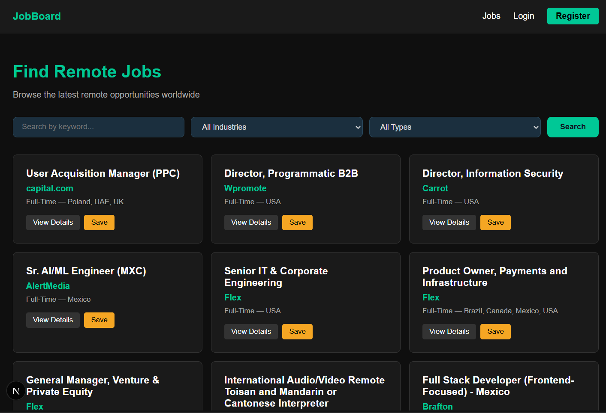
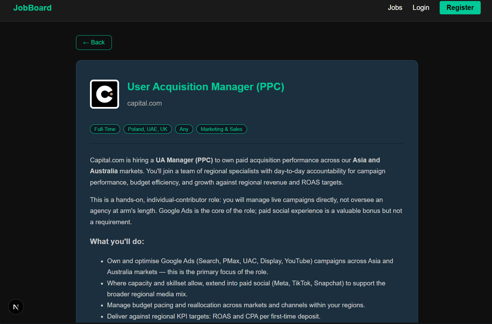

# Job Board

A full-stack job search app. Browse remote job listings, view their details, and (with a MongoDB connection) create an account to save jobs.

> **Status:** work in progress. Job browsing and detail pages work. User accounts and saved jobs require a MongoDB Atlas connection and are not fully tested.

## Features

- Browse job listings from the Jobicy API
- Detail page for each listing
- User registration and login with hashed passwords (bcrypt) and sessions
- Save jobs to your account (requires login)

## Tech Stack

- Frontend: Next.js, React
- Backend: Node.js, Express.js
- Database: MongoDB (Mongoose)
- Auth: bcrypt, express-session
- External API: Jobicy

## Screenshots

| Listings | Job details |
|----------|-------------|
|  |  |

## Getting Started

### Backend

1. `cd backend`
2. `npm install`
3. Copy `.env.example` to `.env` and fill in your values (including a MongoDB Atlas connection string)
4. `node server.js` (runs on http://localhost:5000)

### Frontend

1. `cd frontend`
2. `npm install`
3. `npm run dev` (runs on http://localhost:3000)

## What I Learned

Building this project taught me how to connect a Next.js frontend to an Express API, consume an external REST API, and structure a backend with routes, controllers and models. It also taught me to keep credentials in environment variables instead of in the code.

## Author

Kensel Sepúlveda — [GitHub](https://github.com/KenselSecE)